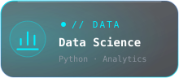
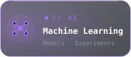
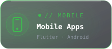

<div align='center'>
  
## Hi there <a href="#"></a>

<p> <a href='#'>
  
</a>

  </p>

  <div align="center">

<a href="https://github.com/Saphall/Machine-Learning"></a>
<a href="https://github.com/Saphall/Machine-Learning"></a>
<a href="https://github.com/Saphall/Flutter"></a>
<a href="https://github.com/Saphall/Django-and-Flask"></a>
<a href="https://github.com/d43mOne"></a>

</div>
  
```html
< Just Code />
```

<!--
**Saphall/Saphall** is a ✨ _special_ ✨ repository because its `README.md` (this file) appears on your GitHub profile.

Here are some ideas to get you started:

- 🔭 I’m currently working on ...
- 🌱 I’m currently learning ...
- 👯 I’m looking to collaborate on ...
- 🤔 I’m looking for help with ...
- 💬 Ask me about ...
- 📫 How to reach me: ...
- 😄 Pronouns: ...
- ⚡ Fun fact: ...
-->
  
<a href="#">
</a></br>


</br>

## 🌱 Github Stats:
  
<p >
  
</a></p>

<br>

<div align="center">

[](https://github.com/Saphall)
[](https://github.com/d43mOne)

<br>

</div>
  
## ⚡ Holopin Board :
  
[](https://holopin.io/@saphall)
